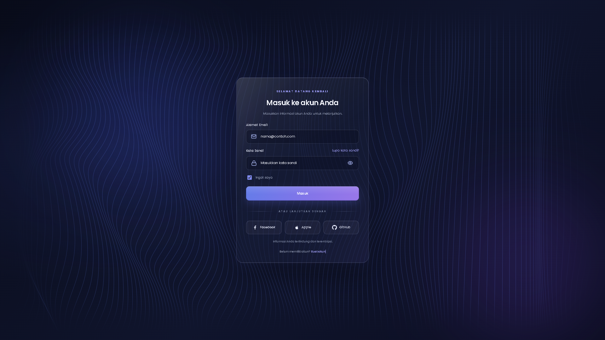
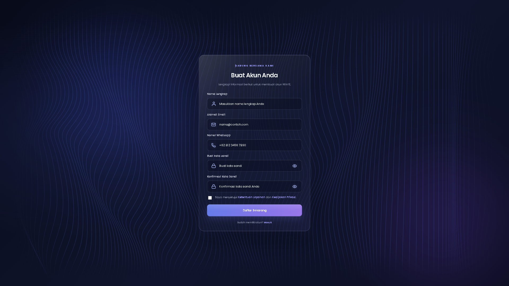

# UI Using React - Login and Register

A modern and responsive Login and Register user interface built with React.

## Preview

### Login Page



### Register Page



## Features

- Modern Login interface
- Registration interface
- Responsive layout
- Password visibility toggle
- Form input icons
- Animated wave background
- Modern visual effects and styling

## Built With

- React
- Vite
- JavaScript
- CSS3
- HTML5

## Getting Started

### Prerequisites

Make sure you have installed:

- Node.js
- npm

### Installation

Clone this repository:

```bash
git clone https://github.com/awlxdev/ui-using-react-login-and-register.git
```

Navigate to the project directory:

```bash
cd ui-using-react-login-and-register
```

Install dependencies:

```bash
npm install
```

### Run Development Server

```bash
npm run dev
```

Open the local URL displayed in your terminal.

### Build for Production

```bash
npm run build
```

## Project Structure

```text
login-part1/
├── public/
│   ├── images/
│   ├── favicon.svg
│   └── icons.svg
├── src/
│   ├── assets/
│   ├── component/
│   ├── components/
│   ├── styles/
│   ├── App.jsx
│   ├── App.css
│   ├── index.css
│   └── main.jsx
├── index.html
├── package.json
└── vite.config.js
```

## Repository

GitHub: https://github.com/awlxdev/ui-using-react-login-and-register

## License

This project is licensed under the MIT License.
See the [LICENSE](./LICENSE) file for details.

---

Developed by **awlxdev**.
